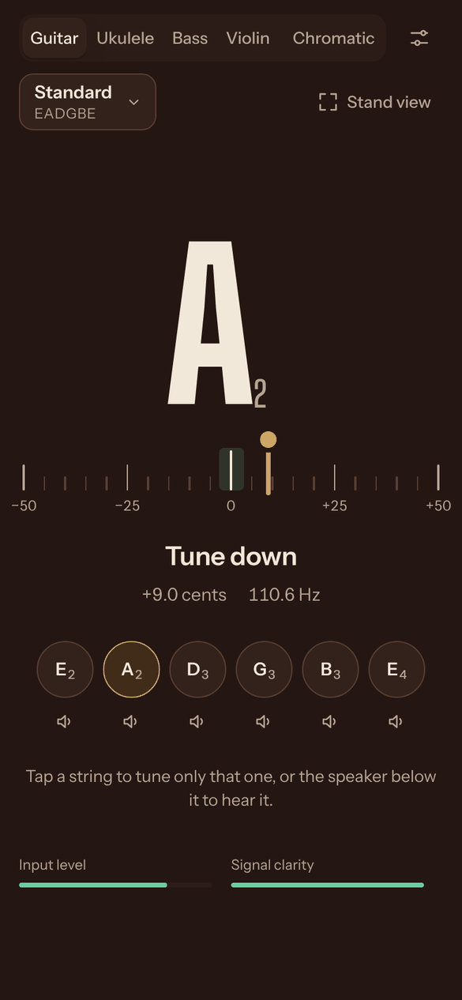
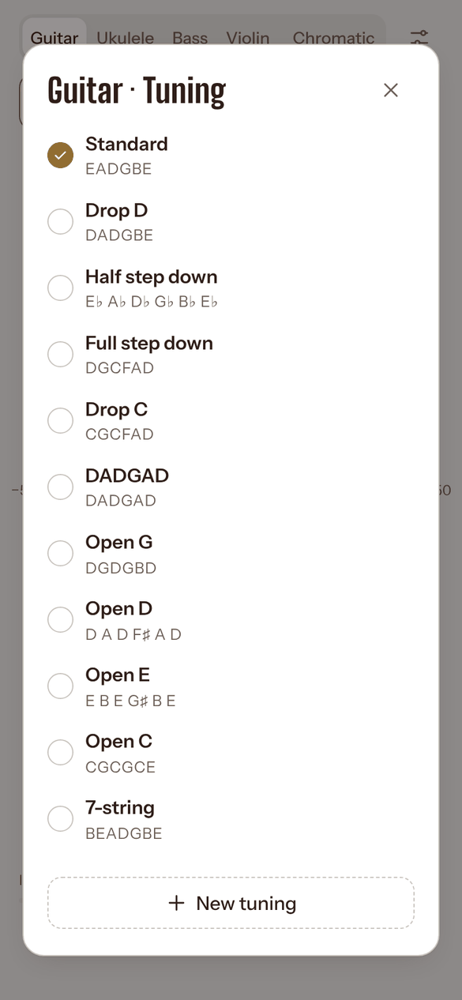

# Instrument Tuner

A precise tuner for **guitar, bass, ukulele and violin**, with a chromatic mode for everything else. It runs in your browser, installs like an app on your phone or computer, and works offline. Free, with no ads and no account.

### [**Open the tuner →**](https://mhoangtrinh.github.io/instrument-tuner/)

  
  &nbsp;
  
  &nbsp;
  

## What you get

- **Just play.** The tuner finds which string you're playing and shows how far off it is, to the cent. Keep turning the peg while the string rings; the needle follows along.
- **24 tunings and your own:** Drop D, DADGAD, open tunings, half step down, 7-string guitar, 5- and 6-string bass, low-G and baritone ukulele, viola and more. Or make your own with any notes.
- **Hear every string.** Tap the speaker under a string to hear its note, played by a real guitar or violin, so you can tune by ear.
- **Stand view.** A huge note, arrow and colour you can read from across the room. The screen turns green when you're in tune.
- **Works offline**, once you've opened it.
- **Your sound stays on your device.** The microphone is analysed on your phone or computer; nothing is uploaded.
- **Your settings:** adjust the reference pitch (A4, e.g. 432 or 442 Hz) and how strict "in tune" is, pick a microphone or audio interface, and choose a light or dark look.

## Install it

| Device | How |
|---|---|
| **iPhone / iPad** | Open the link in **Safari** → **Share** → **Add to Home Screen**. Open it once from the home screen while online; after that it works offline. |
| **Android** | Open the link in **Chrome** → menu → **Install app**. |
| **Windows / Mac** | In **Chrome** or **Edge**, click the install icon at the right of the address bar. On a Mac in **Safari**: **File → Add to Dock**. |

When there's a new version, the app shows *A new version is ready – Update*.

## Tuning in four steps

1. Tap **Start tuning** and allow the microphone.
2. Pick your instrument at the top, and your tuning just below it.
3. Play one string. **Tune up** means tighten it, **Tune down** means loosen it.
4. When it turns **green**, it's in tune, and the string gets a green dot. Move on to the next.

Tap a string to tune only that one. **Chromatic** names any note, for other instruments.

## Tips

- **Bass:** hold the phone close to the instrument or its amp. Low notes are hard for phone microphones to hear from across a room.
- **Noisy room:** move the phone closer and pluck a little harder.
- **Something looks wrong?** Right after it happens, open Settings → **Save the last 10 seconds**, and send the file along with a short description.

## Credits

Guitar sounds: [University of Iowa Electronic Music Studios](https://theremin.music.uiowa.edu/MIS.html). Violin sounds: [VSCO 2 Community Edition](https://versilian-studios.com/vsco-community/) (CC0). Built from my own MATLAB tuner project.

Developer notes are in [DEVELOPMENT.md](DEVELOPMENT.md).
